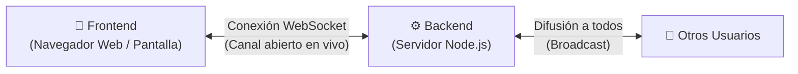
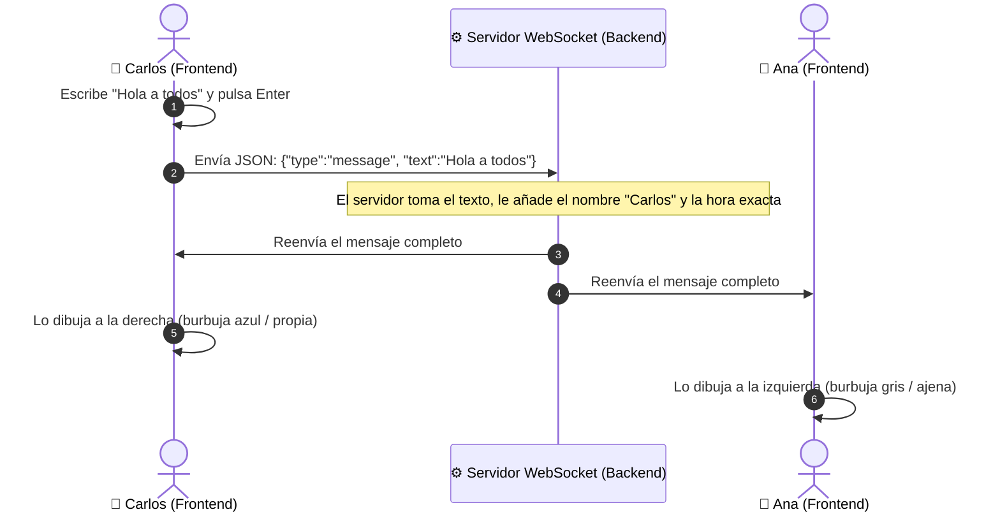

# Guía Didáctica: Arquitectura y Funcionamiento del Chat en Tiempo Real

¡Hola! Te doy la bienvenida a esta guía didáctica. Como tu docente de desarrollo de software, este documento está diseñado con un enfoque claro, visual y paso a paso para que comprendas el funcionamiento integral de esta aplicación de chat en tiempo real.

Para que el proyecto sea modular y ordenado, el código se organiza en **dos ramas principales de Git**:
1. **Rama `backend`**: El servidor y la lógica interna (el "cerebro" detrás de escena).
2. **Rama `frontend`**: La pantalla con la que interactúa la persona usuaria (la "cara visible").

---

## 1. La Gran Imagen: ¿Cómo cooperan las dos partes?

Imagina un programa de radio interactivo:
* **El Frontend** es la persona oyente con su teléfono: escribe su mensaje y lo envía.
* **El Backend** es la cabina de radio: recibe la llamada, lee el mensaje en voz alta por el micrófono y lo escuchan todas las personas conectadas al mismo tiempo.



### ¿Qué tecnología usan para hablarse? (WebSocket)
En las páginas web tradicionales, el navegador pide algo y el servidor responde una sola vez (como enviar una carta). 

En este chat usamos **WebSockets**:
* Funciona como una **llamada telefónica que nunca se cuelga**.
* La línea de comunicación permanece abierta en todo momento. En cuanto alguien envía un mensaje, este llega al instante a los demás sin necesidad de recargar la página.

---

## 2. Rama `backend`: El Servidor Central

El backend no tiene botones ni colores; es un programa que corre en un servidor y se encarga de recibir, ordenar y repartir los mensajes.

### A. package.json: El inventario del proyecto
Piensa en este archivo como la **ficha de identificación y la lista de herramientas**:
* **`name` y `version`**: Identifican el proyecto (`chat-backend`).
* **`scripts`**: Contiene el atajo `npm start`, que ejecuta `node server.js` para encender el servidor.
* **`dependencies`**: Indica qué librería externa necesita el proyecto. Aquí únicamente utiliza `"ws": "^8.18.0"`, que es la herramienta especializada en crear servidores WebSocket en Node.js.

---

### B. server.js: El cerebro del chat

Este archivo contiene toda la lógica viva del servidor. Se compone de 4 partes fundamentales:

#### 1. Creación del Servidor
```javascript
const PORT = process.env.PORT || 8080;
const wss = new WebSocketServer({ port: PORT });
```
* Abre una "puerta de escucha" en el puerto **8080** (o el que defina el entorno en la nube).
* `clients = new Map()`: Es una libreta de notas donde el servidor registra a cada persona conectada y qué nombre tiene asignado.

#### 2. La función `broadcast` (El megáfono)
```javascript
function broadcast(payload, senderWs = null) { ... }
```
* Recibe un mensaje en formato JavaScript, lo convierte en texto plano (`JSON.stringify`) y recorre a todos los clientes conectados para enviárselo a cada uno.

#### 3. El ciclo de vida de una conexión (`wss.on('connection')`)
Cuando alguien abre la aplicación, el servidor activa un receptor de eventos:
* **Al conectarse**: Guarda al cliente en la libreta con el nombre provisional `"Anónimo"`.
* **Al recibir un mensaje (`ws.on('message')`)**:
  * Si el tipo es `'join'`: El usuario notificó su nombre. El servidor avisa a todos: *"[Nombre] se ha unido al chat."*
  * Si el tipo es `'message'`: El usuario envió un texto. El servidor empaqueta el texto, quién lo mandó y la hora exacta (`timestamp`), y lo envía a todos.
* **Al desconectarse (`ws.on('close')`)**: El servidor borra al usuario de su libreta y avisa a todos: *"[Nombre] ha salido del chat."*
* **Control de fallos (`ws.on('error')`)**: Registra en la consola si ocurrió un corte inesperado para evitar que el programa se detenga.

---

### C. Dockerfile del Backend: La caja estandarizada

Un `Dockerfile` es una **receta de cocina** para que el backend funcione exactamente igual en cualquier computadora o servidor del mundo, usando Docker:

| Instrucción en el Dockerfile | ¿Qué significa en lenguaje sencillo? |
| :--- | :--- |
| `FROM node:20-alpine` | Elige un sistema operativo base muy pequeño y ligero con Node.js ya instalado. |
| `WORKDIR /app` | Crea una carpeta de trabajo llamada `/app` dentro del contenedor. |
| `COPY package*.json ./` | Copia la lista de herramientas antes del código (para optimizar la memoria caché). |
| `RUN npm install --only=production` | Descarga la librería `ws` necesaria para que el servidor funcione. |
| `COPY . .` | Copia el resto de los archivos (`server.js`). |
| `EXPOSE 8080` | Declara que el contenedor va a comunicarse por el puerto 8080. |
| `CMD ["node", "server.js"]` | Es el botón de arranque: enciende el servidor al iniciar el contenedor. |

---

## 3. Rama `frontend`: La Interfaz del Usuario

Esta rama contiene los archivos que el navegador web descarga para que la persona pueda ver el chat, escribir y hacer clic.

### A. index.html: El esqueleto visual
Organiza la pantalla en tres zonas:
1. **Encabezado (`chat-header`)**: Muestra el título, el indicador luminoso de conexión (verde/rojo) y la caja para cambiar tu nombre de usuario.
2. **Área de mensajes (`messages-container`)**: El espacio central donde van apareciendo las burbujas de texto.
3. **Barra de envío (`chat-form`)**: El campo para escribir y el botón "Enviar".
4. **Carga de scripts**: Al final del archivo incluye a `config.js` y luego a `app.js`.

---

### B. config.js: La libreta de direcciones

Es un archivo corto pero crucial:
```javascript
const CONFIG = {
  WS_HOST: 'localhost',
  WS_PORT: 8080,
  get WS_URL() {
    return `ws://${this.WS_HOST}:${this.WS_PORT}`;
  }
};
```
* Guarda la dirección donde está ubicado el servidor (`localhost` en el puerto `8080`).
* **¿Por qué está separado?** Si mañana el backend se sube a internet en un servidor real, solo se actualiza esta dirección sin tener que modificar la lógica de la aplicación.

---

### C. app.js: La interacción y la vida de la pantalla

Este archivo conecta lo que el usuario hace en pantalla con el servidor WebSocket:

#### 1. Memoria local y nombre de usuario
* Comprueba si la persona ya tenía un nombre guardado en su navegador (`localStorage.getItem('chat_username')`).
* Si no tiene ninguno, le inventa uno automático y aleatorio (por ejemplo, `Usuario_4521`).

#### 2. Funciones de protección y formato
* **`escapeHTML(str)` (Filtro de seguridad)**: Evita ataques de inyección de código (XSS). Transforma caracteres especiales para que siempre se muestren como texto inofensivo.
* **`formatTime(isoString)`**: Convierte la fecha del servidor en una hora amigable (por ejemplo, `10:15`).
* **`setConnectionStatus(connected)`**: Si hay conexión, enciende el punto verde, muestra "Conectado" y desbloquea el botón de enviar. Si se cae la conexión, enciende el punto rojo y bloquea el botón para evitar errores.

#### 3. Conexión WebSocket y auto-reconexión (`initWebSocket`)
* Establece el enlace con la dirección configurada en `config.js`.
* **Al abrirse (`socket.onopen`)**: Envía un mensaje especial de tipo `'join'` con el nombre de usuario.
* **Al recibir mensajes (`socket.onmessage`)**:
  * Si es del sistema: Llama a `renderSystemMessage` (texto gris al centro).
  * Si es de una persona: Llama a `renderUserMessage` (burbuja a la derecha si es mío, o a la izquierda si es de otra persona).
* **Si se desconecta (`socket.onclose`)**: Espera 3 segundos (`setTimeout`) y vuelve a intentar conectarse automáticamente.

---

### D. Dockerfile del Frontend: Servir los archivos

A diferencia del backend, el frontend sólo contiene archivos estáticos (HTML, JS, CSS). 

* Usa la imagen base ligera `node:20-alpine` e instala una herramienta llamada `serve`.
* `serve` es un servidor web muy sencillo que toma los archivos de la carpeta y los entrega a los navegadores que ingresen al puerto **3000** (`CMD ["sh", "-c", "npx serve -s . -l ${PORT:-3000}"]`).

---

## 4. Paso a Paso: El Viaje de un Mensaje

Veamos qué ocurre exactamente cuando un usuario llamado **Carlos** escribe `"Hola a todos"`:



1. **Carlos escribe y presiona Enter**: El formulario en `app.js` detecta el evento `submit`.
2. **Empaquetado**: `app.js` arma un paquete en formato JSON: `{"type": "message", "text": "Hola a todos"}` y lo dispara a través del WebSocket.
3. **Recepción en Backend**: `server.js` recibe el paquete, identifica que vino del socket de Carlos y le estampa la marca de tiempo actual (`new Date().toISOString()`).
4. **Megáfono (Broadcast)**: El servidor recorre todas las conexiones activas y les manda el paquete completo:
   ```json
   {
     "type": "message",
     "username": "Carlos",
     "text": "Hola a todos",
     "timestamp": "2026-09-28T14:35:00.000Z"
   }
   ```
5. **Recepción en Pantalla**: El navegador de cada persona conectada recibe el paquete.
6. **Dibujado en Pantalla**:
   * En la pantalla de Carlos: Como el emisor es él mismo, `app.js` dibuja la burbuja como mensaje saliente (`outgoing`).
   * En la pantalla de Ana: Como el emisor es distinto, `app.js` dibuja la burbuja como mensaje entrante (`incoming`).

---

## 5. Resumen de Conceptos Clave

* **Rama `backend`**: El centro de distribución. Sabe quién está conectado y reenvía los mensajes a través de `server.js`.
* **Rama `frontend`**: La cara visual. Captura lo que escribe el usuario en `index.html` y lo envía a través de `app.js`.
* **WebSocket**: El canal directo en tiempo real que mantiene comunicadas ambas ramas todo el tiempo.
* **Dockerfile**: Las instrucciones paso a paso para meter cada parte dentro de un contenedor estándar y poder ejecutarlo en cualquier máquina.
